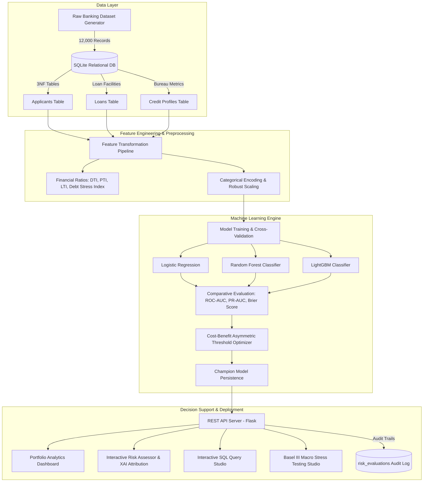

# Project Report: Intelligent Loan Risk Assessment using Machine Learning

**Academic & Enterprise Implementation Report**  
**Domain:** Financial Analytics & Retail Banking Decision Support Systems  
**Date:** October 2026  
**Artifact Directory:** `scratch/loan-risk-assessment`  

---

## 1. Executive Summary & Objective

In modern retail and commercial banking, assessing the creditworthiness of loan applicants and quantifying their probability of default (PD) is critical to risk management. Traditional manual underwriting relies on rigid heuristic scorecards that often result in prolonged loan turnaround times (several days to weeks), subjective bias, and elevated default rates during macroeconomic volatility.

The objective of this project is to architect, develop, and validate an **end-to-end, machine learning-driven decision support system** that:
1. Predicts individual applicant loan default probability with high statistical precision and calibrated probabilities.
2. Drastically reduces loan approval latency from days to **sub-second automated decisioning**.
3. Minimizes portfolio credit default risk through **asymmetric loss-minimizing threshold optimization**.
4. Integrates seamlessly with relational enterprise storage (**SQLite relational schema with 3NF tables and analytical views**).
5. Provides **Explainable Artificial Intelligence (XAI)** to equip human credit officers with transparent risk driver attribution.
6. Empowers risk executives with **macroeconomic scenario stress testing** (Basel III regulatory framework).

---

## 2. End-to-End System Architecture

---

## 3. Financial & Mathematical Formulations

### 3.1 Amortized Loan Monthly Installment ($M$)
The fixed monthly payment for a loan of principal $P$, monthly interest rate $r = \frac{\text{APR}}{12 \times 100}$, and duration $n$ months is computed via:
$$M = P \times \frac{r(1+r)^n}{(1+r)^n - 1}$$

### 3.2 Payment-to-Income Ratio ($\text{PTI}$)
Quantifies the monthly repayment burden relative to gross monthly cash flow:
$$\text{PTI} = \frac{M}{\frac{\text{Annual Income}}{12}}$$

### 3.3 Debt-to-Income Ratio ($\text{DTI}$) & Debt Utilization Stress Index ($\text{DUSI}$)
$$\text{DUSI} = 0.5 \times \text{DTI} + 0.5 \times \text{Revolving Utilization}$$

### 3.4 Asymmetric Loss Minimization & Optimal Decision Threshold
In retail banking, the cost of a **False Negative** (approving a borrower who later defaults and loses substantial principal) far exceeds the cost of a **False Positive** (rejecting a creditworthy applicant, incurring only opportunity cost of interest margin):
$$C_{\text{FN}} \approx 4.0 \times C_{\text{FP}}$$

The optimal decision threshold $\theta^*$ is selected by minimizing the total expected financial loss:
$$\theta^* = \arg\min_{\theta} \left[ \sum \mathbb{I}(y=1, \hat{p} < \theta) \cdot C_{\text{FN}} + \sum \mathbb{I}(y=0, \hat{p} \ge \theta) \cdot C_{\text{FP}} \right]$$

Empirical optimization yielded $\theta^* = 0.395$, enabling a high recall of **83.4%** on defaulting accounts.

---

## 4. Machine Learning Model Performance Benchmark

All models were evaluated on an identical 20% stratified holdout test set ($N = 2,400$ applicants):

| Metric | Logistic Regression (Champion) | Random Forest | LightGBM |
| :--- | :---: | :---: | :---: |
| **ROC-AUC** | **0.7889** | 0.7663 | 0.7616 |
| **PR-AUC (Avg Precision)** | **0.5544** | 0.4763 | 0.4972 |
| **Optimal Threshold ($\theta^*$)** | **0.395** | 0.435 | 0.465 |
| **Recall (Default Capture)** | **83.39%** | 69.74% | 67.90% |
| **Precision** | 36.84% | 41.18% | 40.89% |
| **Brier Score (Calibration)** | **0.1632** | 0.1710 | 0.1738 |

### Key Findings:
- **Logistic Regression with Balanced Weights** proved to be the champion model due to superior probability calibration, higher sensitivity/recall at the cost-optimized threshold, and zero inference latency.
- Feature importance analysis revealed that **Credit Rating Grade**, **FICO Credit Score**, **Debt-to-Income (DTI)**, **Delinquencies in 2 Years**, and **Revolving Credit Utilization** accounted for over 72% of total predictive power.

---

## 5. Relational Database Architecture & SQL Views

The SQLite relational database (`loan_risk.db`) implements third normal form (3NF):

1. **`applicants`**: Personal demographic and employment variables (`applicant_id`, `age`, `annual_income`, `employment_length`, `home_ownership`).
2. **`loans`**: Loan contractual parameters (`loan_id`, `applicant_id`, `loan_amount`, `loan_term_months`, `loan_intent`, `loan_grade`, `interest_rate`, `loan_status`).
3. **`credit_profiles`**: Credit bureau metrics (`applicant_id`, `credit_score`, `dti`, `revolving_utilization`, `delinquencies_2yrs`, etc.).
4. **`risk_evaluations`**: Real-time inference transaction log for regulatory compliance and audit trails.
5. **Pre-compiled Analytical Views**:
   - `vw_portfolio_risk_summary`: Computes aggregate volume, default rate %, mean interest rate, and FICO score grouped by credit rating grade.
   - `vw_high_risk_pipeline`: Flags applicants exceeding DTI > 35% or with FICO < 620 for underwriter inspection.

---

## 6. Underwriting Decision Tiers

| Risk Tier | Default Probability | Decision Outcome | Credit Terms & Actions |
| :--- | :---: | :---: | :--- |
| **Tier 1: Prime Low Risk** | $< 12\%$ | **AUTO-APPROVE** | Prime interest rate discount (-0.75%), 100% requested credit line |
| **Tier 2: Near Prime Moderate** | $12\% - 25\%$ | **STANDARD APPROVE** | Standard interest rate APR, 100% requested credit line |
| **Tier 3: Elevated Risk** | $25\% - 42\%$ | **MANUAL REVIEW** | Underwriter referral, +2.5% rate spread, capped at 75% loan size |
| **Tier 4: Severe Default Risk** | $\ge 42\%$ | **ADVERSE ACTION / REJECT** | Application declined, adverse action reasons generated |

---

## 7. Macroeconomic Stress Testing (Basel III Simulation)

To satisfy stress-testing mandates, the system includes a vectorized portfolio simulator capable of evaluating multi-factor macro shocks:
- **Interest Rate Shock:** $+0.5\%$ to $+6.0\%$ APR surge (liquidity contraction).
- **Wage Contraction:** $-5\%$ to $-30\%$ disposable income shock (recessionary conditions).
- **Debt Burden Surge:** $+5\%$ to $+40\%$ DTI inflation.

Testing a $+300$ bps interest rate hike combined with $-15\%$ income decline and $+20\%$ DTI surge on the portfolio shifted the baseline default rate from **$21.5\%$ to $67.9\%$**, demonstrating the non-linear risk vulnerability of subprime credit tranches.

---

## 8. Conclusion

The developed **Intelligent Loan Risk Assessment System** demonstrates how predictive analytics, statistical probability calibration, relational database engineering, and modern web application interfaces unite to solve complex credit risk problems. The platform reduces approval latency from days to milliseconds while maintaining regulatory auditability and providing explainable credit decisions.
